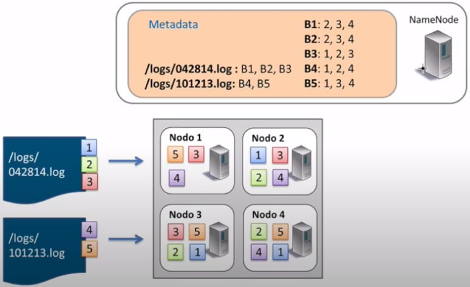

# Práctica 1.1. Arquitectura de almacenamiento, integridad distribuida y formatos analíticos (HDFS, MinIO y Parquet)

**Módulo:** Big Data Aplicado (5075)  
**Curso de especialización:** Inteligencia Artificial y Big Data  
**Centro:** IES Gran Capitán (Córdoba)  
**Modalidad:** Individual  
**Entorno:** Laboratorio Docker Compose de la UD 1  
**Calificación orientativa de la práctica:** 0 a 10. **Evaluación oficial:** calificaciones independientes por CE, según la programación didáctica; la nota global no sustituye a las notas por CE.

## 1. Planteamiento

Una empresa de comercio electrónico necesita conservar las transacciones originales, obtener una representación más apropiada para el análisis y comprobar qué sucede cuando falla un servicio de almacenamiento o se corrompe una réplica.

En esta práctica **aplicarás el laboratorio de la UD 1 y justificarás tus decisiones**. El laboratorio contiene las instrucciones de instalación y los comandos explicados; este enunciado establece las actividades y las evidencias que debes entregar. No tienes que diseñar un Docker Compose nuevo ni desplegar una infraestructura adicional.

### Aprendizajes y trazabilidad por criterios de evaluación

La práctica recoge evidencias de **ocho criterios de evaluación** de los resultados RA1, RA2 y RA3. Cada indicador de la rúbrica pública se asigna a **un CE principal**, sin duplicar puntuaciones entre CE.

| CE | Evidencia específica de P1.1 | Máximo interno |
|---|---|---:|
| 1.a | Arquitectura HDFS y comparación de modelos HDFS/S3 (1.1, 3.2) | 2,0 |
| 1.c | Generación, medición e interpretación de CSV y Parquet (4.1–4.3) | 2,5 |
| 2.a | Disponibilidad y localidad en sistemas distribuidos (1.2, 1.3) | 1,6 |
| 2.d | Conservación de datos originales en Bronze/objeto antes de decidir su explotación (3.1) | 0,9 |
| 3.a | Estado del clúster y relevancia de la calidad/integridad (2.1) | 0,6 |
| 3.b | Riesgos de integridad y efectos de fallos/corrupción al aumentar el volumen (2.2) | 0,8 |
| 3.c | Reconocimiento y comprobación de checksums del sistema de ficheros distribuido (2.3) | 1,2 |
| 3.d | Papel de los servidores y pasos previos a verificar checksums (2.4) | 0,4 |
| **Total** | **12 indicadores** | **10,0** |

**Cómo se califica:** el profesorado normaliza por separado cada subtotal del CE a una escala de 0 a 10. Los pesos que combinen esta práctica con otras evidencias del mismo CE se establecen en la programación; no se deducen de los máximos internos de la tabla.

> **Requisitos previos**
> Debes haber preparado el entorno indicado en el **apartado 2 del laboratorio `5_lab_hdfs_docker.md`**: Docker Engine y Docker Compose en Linux, o Docker Desktop con WSL 2 en Windows; Python 3, terminal, editor y acceso a Internet para descargar imágenes. Utiliza el manifiesto `docker-compose.yaml`, `hadoop.env` y los scripts `data/generar_ventas.py` y `data/convertir_parquet.py` que figuran en la documentación de la UD 1.
>
> Los comandos `docker` y `docker compose` funcionan tanto en Bash como en PowerShell. Las instrucciones de creación del entorno Python y las comprobaciones de archivos locales tienen variantes para ambos sistemas en el laboratorio.
>
> **Precaución con el experimento de corrupción**
> La modificación física de una réplica es **destructiva** y solo se realizará sobre `/laboratorio-corrupcion/copia.csv`, en un entorno desechable y siguiendo el apartado 7.2 del laboratorio. No se modificarán archivos originales, rutas aproximadas, bloques elegidos mediante comodines ni archivos `.meta`. Si no se cumplen las comprobaciones previas, detén la prueba y documenta el problema.
>
## 2. Entrega y repositorio

La entrega se realizará en el repositorio privado facilitado mediante GitHub Classroom. Es **obligatorio** utilizar el archivo `PLANTILLA_MEMORIA_P1_1.md`: completa sus apartados y guarda el resultado como **`MEMORIA_PRACTICA_1_1.md` en la raíz del repositorio**. No modifiques los encabezados numerados, pues se usarán en la corrección de repositorios. Guarda las capturas de ejecución en `evidencias/` y enlázalas con rutas relativas, por ejemplo ``. La ilustración proporcionada para el hito 1 permanece en `img/`.

La memoria debe contener las **salidas reales** obtenidas, las respuestas a las preguntas y una interpretación técnica. No sustituyas mediciones por cifras ilustrativas de la documentación. Para **cada apartado** de la plantilla incluye las sentencias/comandos ejecutados como texto en bloques de código, el resultado o medida obtenida y su interpretación; las capturas son complementarias. Si algo falla, conserva el apartado e indica qué comprobaste. No hace falta copiar páginas enteras del laboratorio ni capturar cada comando: aporta evidencias representativas y legibles.

Puedes realizar `git commit` y `git push` tantas veces como necesites. Se valorará que el repositorio tenga una organización clara y que los cambios sean comprensibles. **La práctica no dispone de autocorrección automática:** el profesor revisará la memoria, las evidencias aportadas y el repositorio utilizando la rúbrica del apartado 4.

> **Orden recomendado**
> 1. Genera los datos y conviértelos a Parquet.
> 2. Comprueba el almacenamiento en HDFS y MinIO.
> 3. Completa las pruebas de disponibilidad e integridad.
> 4. Resuelve el análisis de la figura y redacta las conclusiones.
>
> Los hitos se presentan a continuación por objetivos de aprendizaje, no por obligación de ejecución secuencial.
>
## 3. Hitos de la práctica

### Hito 1. Arquitectura de HDFS y disponibilidad (2,5 puntos)

Observa la siguiente distribución **didáctica** de metadatos y bloques. No representa el clúster Docker de dos DataNodes que utilizarás después.



*Figura P1.1. Distribución de bloques y réplicas en un clúster HDFS de cuatro nodos. Material aportado para la práctica.*

**Actividad 1.1. Lectura de un archivo.** Un cliente solicita `/logs/101213.log`.

- Identifica los bloques que componen el archivo y los nodos que conservan cada réplica. Deduce el factor de replicación representado.
- Describe la secuencia de lectura: consulta al NameNode para conocer las ubicaciones, elección de un DataNode y transferencia del bloque al cliente. Explica por qué los datos no circulan normalmente a través del NameNode.
- Indica qué información gestiona el NameNode y qué almacenan los DataNodes.

**Actividad 1.2. Fallo simultáneo.** Los nodos 1 y 4 quedan fuera de servicio.

- Indica qué réplicas sobreviven de los bloques necesarios para leer `/logs/101213.log` y `/logs/042814.log`.
- Justifica si ambos archivos pueden leerse íntegramente. Diferencia *disponibilidad*, *pérdida de una réplica* y *pérdida definitiva de los datos*.
- ¿Podría recuperarse automáticamente el factor de replicación original con los nodos disponibles? Razona qué recursos harían falta y qué limitaciones impone el estado del clúster.

**Actividad 1.3. Localidad de los datos.** Para procesar B5, identifica los nodos que contienen sus réplicas y explica en qué condiciones un motor de procesamiento que admita planificación por localidad podría aprovecharlas. No supongas que cualquier motor o arquitectura garantiza ejecución `NODE_LOCAL`.

**Evidencia:** respuestas razonadas con referencias a la figura y una breve explicación del flujo de red.

### Hito 2. Integridad y tolerancia a fallos de HDFS (3 puntos)

**Actividad 2.1. Comprobar el estado inicial.** Una vez generados los datos, inicia el perfil `storage`, sube el CSV a `/lakehouse/bronze/ventas/` y registra:

```bash
# Consultar el estado de los DataNodes.
docker exec namenode hdfs dfsadmin -report

# Obtener bloques y ubicaciones del CSV.
docker exec namenode hdfs fsck /lakehouse/bronze/ventas/ventas_ecommerce.csv -files -blocks -locations

# Comparar tamaño lógico y espacio consumido con réplicas.
docker exec namenode hdfs dfs -du -h /lakehouse/bronze/ventas
```

Anota el número de bloques, el factor esperado, cuántos DataNodes conservan cada bloque y el espacio ocupado. Explica por qué un archivo menor que el tamaño de bloque configurado no necesita reservar 128 MiB por réplica.

**Actividad 2.2. Interrupción de un DataNode.** Sigue **el apartado 7.1 del laboratorio**: detén `datanode1`, intenta recuperar el archivo, compara los hashes SHA-256 del original y de la copia descargada, consulta `fsck` y restablece el servicio. Si aparecen mensajes `WARN`, distingue un reintento de lectura de un fallo definitivo. Registra qué ocurrió realmente en tu ejecución y cuánto tiempo tardó aproximadamente la recuperación. **Relaciona el riesgo de integridad con el aumento del volumen y del número de bloques/transferencias:** explica por qué un conjunto mayor de datos amplía la superficie de posibles errores, sin afirmar que necesariamente se corromperá.

**Actividad 2.3. Corrupción física de una réplica.** Sigue **el apartado 7.2 del laboratorio** y trabaja únicamente sobre `/laboratorio-corrupcion/copia.csv`.

1. Antes de modificar nada, verifica con `fsck` que el archivo de ensayo tiene dos réplicas sanas y anota el identificador real `blk_...` y su *generation stamp*.
2. Localiza en ambos DataNodes el archivo físico de ese bloque, así como el `.meta` correspondiente. Comprueba los checksums iniciales mediante `hdfs debug verifyMeta`.
3. Detén el DataNode que contiene la réplica que vas a alterar y utiliza **la ruta completa y real** obtenida en tu instalación. Modifica **un byte** mediante el comando del laboratorio, no mediante el antiguo comando con `find` y `dd` de 512 bytes.
4. Reinicia el servicio. Inspecciona logs, resultado de `fsck`, posibles errores de checksum y disponibilidad del archivo. Compara por SHA-256 el archivo recuperado con el CSV original.
5. Explica separadamente **detección de corrupción**, **lectura desde otra réplica** y **reconstrucción de redundancia**. **Identifica expresamente las sumas de verificación de HDFS, qué comprueba `verifyMeta` y por qué SHA-256 del archivo completo es una comprobación externa distinta del checksum de bloques de HDFS.** No se exige una combinación fija de mensajes, ni que HDFS detecte inmediatamente la corrupción, ni que repare al instante la segunda réplica.

> **Si la prueba no puede completarse**
> Si no localizas inequívocamente el bloque o falta una réplica sana, **no fuerces el experimento**. Entrega las comprobaciones realizadas, el motivo por el que te detuviste y tu explicación técnica. La seguridad del procedimiento forma parte de la valoración.
>
**Evidencias:** informes antes/después, identificador real del bloque, rutas verificadas, resultado de `verifyMeta` si está disponible, hash del fichero recuperado y análisis razonado. **Pregunta adicional vinculada a 3.d:** antes de verificar el checksum, explica qué hace el cliente, qué metadatos aporta NameNode, qué hace DataNode cuando lee/transfiere los bytes y en qué punto se contrasta la integridad. No atribuyas al NameNode la lectura de los datos del bloque.

### Hito 3. Almacenamiento de objetos mediante MinIO (2 puntos)

**Actividad 3.1.** Mediante el contenedor `minio-client`, configura el alias `local`, crea el bucket `lakehouse-bronze` si no existe y sube el CSV siguiendo el laboratorio:

```bash
# Registrar el servidor MinIO en el cliente mc.
docker exec minio-client mc alias set local http://minio:9000 minioadmin minioadmin

# Crear el bucket sin fallar si ya existe.
docker exec minio-client mc mb --ignore-existing local/lakehouse-bronze

# Subir los datos con la clave indicada.
docker exec minio-client mc cp /data/ventas_ecommerce.csv local/lakehouse-bronze/2026/10/ventas.csv

# Mostrar las propiedades del objeto.
docker exec minio-client mc stat local/lakehouse-bronze/2026/10/ventas.csv
```

**Actividad 3.2.** Explica qué son el alias `local`, el bucket y la clave del objeto. Indica por qué la clave `2026/10/ventas.csv` no implica tener directorios con la misma semántica que HDFS. Comprueba también el objeto en la consola `http://minio.localhost` o, alternativamente, en `http://localhost:9001`.

**Actividad 3.3.** Compara HDFS y MinIO para conservar los datos originales de la empresa. Incluye cómo se accede a los datos, cómo se organizan y qué ventajas o limitaciones aprecias en este contexto. Puedes comentar por qué la consistencia de lectura después de escritura importa en una arquitectura analítica, sin necesidad de desplegar Iceberg.

**Evidencias:** salida de `mc stat`, vista del objeto en MinIO y comparación razonada. **Pregunta adicional vinculada a 2.d:** explica por qué conservar el CSV original sin transformarlo en Bronze o en un objeto permite decidir posteriormente qué análisis y transformaciones realizar.

### Hito 4. CSV y Parquet: comparar formatos con datos reales (2,5 puntos)

**Actividad 4.1.** Genera el CSV de **100.000 transacciones** con `data/generar_ventas.py` y conviértelo a Parquet comprimido con ZSTD mediante `data/convertir_parquet.py`. Usa el entorno virtual Python explicado en el laboratorio. Comprueba que ambos archivos se han creado y registra sus tamaños en bytes.

**Actividad 4.2.** Conserva el CSV en Bronze y copia Parquet al directorio que utiliza nuestra documentación:

```bash
# Crear el destino de Parquet.
docker exec namenode hdfs dfs -mkdir -p /lakehouse/silver/ventas

# Subir el Parquet comprimido.
docker exec namenode hdfs dfs -put -f /opt/hadoop/shared_data/ventas_ecommerce.zstd.parquet /lakehouse/silver/ventas/

# Comparar los tamaños de ambos formatos y el espacio replicado.
docker exec namenode hdfs dfs -du -h /lakehouse/bronze/ventas /lakehouse/silver/ventas
```

**Actividad 4.3.** Completa la tabla con los valores **medidos**, sin redondeos que oculten diferencias importantes:

| Medida | CSV | Parquet (ZSTD) |
|---|---:|---:|
| Tamaño local (bytes) | Por medir | Por medir |
| Tamaño lógico HDFS | Por medir | Por medir |
| Espacio consumido en HDFS con réplicas | Por medir | Por medir |
| Bloques lógicos HDFS | Por medir | Por medir |
| DataNodes con réplicas de cada bloque | Por observar | Por observar |

Calcula el porcentaje de reducción del tamaño local: `(bytes CSV - bytes Parquet) / bytes CSV × 100`. **No se exige alcanzar un porcentaje predeterminado**. Explica por qué Parquet puede ocupar menos y qué papel tienen el almacenamiento columnar, los tipos de datos, la codificación y la compresión ZSTD.

**Actividad 4.4.** Explica las diferencias entre una comparación de *ocupación de almacenamiento* y una comparación de *rendimiento de consulta*. ¿Permiten estas mediciones afirmar que Parquet siempre se consulta más rápido? ¿Por qué? Señala qué información adicional haría falta para comprobar el rendimiento.

**Evidencias:** salidas de los scripts, tabla de mediciones, cálculo de reducción e interpretación de los resultados.


## 4. Rúbrica y corrección por CE

Consulta **`Rubrica_P1.1.md`**, incluida en el repositorio. Contiene 12 indicadores con cuatro niveles descriptivos, puntos máximos y CE de referencia. La suma interna es 10,0 puntos, pero **se registrará también la nota normalizada de cada uno de los ocho CE**.

El profesor corregirá las evidencias de `MEMORIA_PRACTICA_1_1.md` y las capturas o archivos vinculados desde ella. La falta de un archivo de respuestas organizado puede impedir acreditar partes de la práctica. No hay autocorrección automática ni puntuación por longitud del texto.

## 5. Estructura de entrega

```text
practica-1-1/
├── README.md
├── PLANTILLA_MEMORIA_P1_1.md
├── Rubrica_P1.1.md
├── MEMORIA_PRACTICA_1_1.md      # cumplimentada por el alumno
├── img/
│   └── Practica1.1_HDFS.png
└── evidencias/                  # capturas y evidencias auxiliares
```

El material del laboratorio UD1 se utiliza para **preparar el entorno**. No es necesario copiar aquí el Compose ni sus scripts si la tarea no los solicita.

## 6. Referencias de apoyo

- [Documentación Apache Hadoop HDFS](https://hadoop.apache.org/docs/current/hadoop-project-dist/hadoop-hdfs/HdfsUserGuide.html)
- [Guía de HDFS FSCK](https://hadoop.apache.org/docs/current/hadoop-project-dist/hadoop-hdfs/HdfsUserGuide.html#fsck)
- [Documentación de Apache Parquet](https://parquet.apache.org/docs/)
- [Documentación de MinIO Client](https://min.io/docs/minio/linux/reference/minio-mc.html)